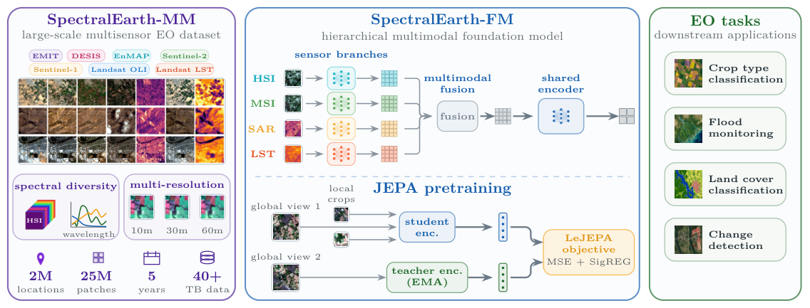
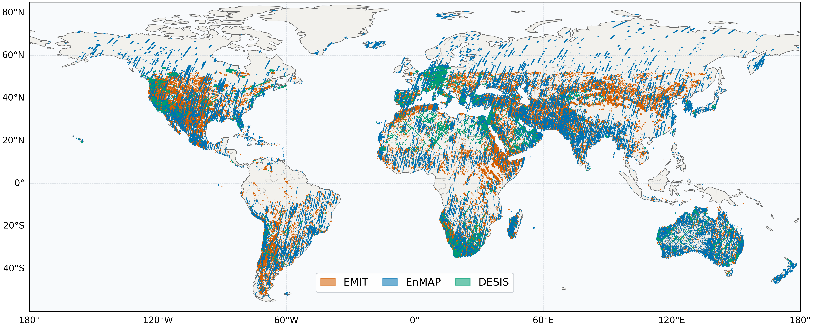
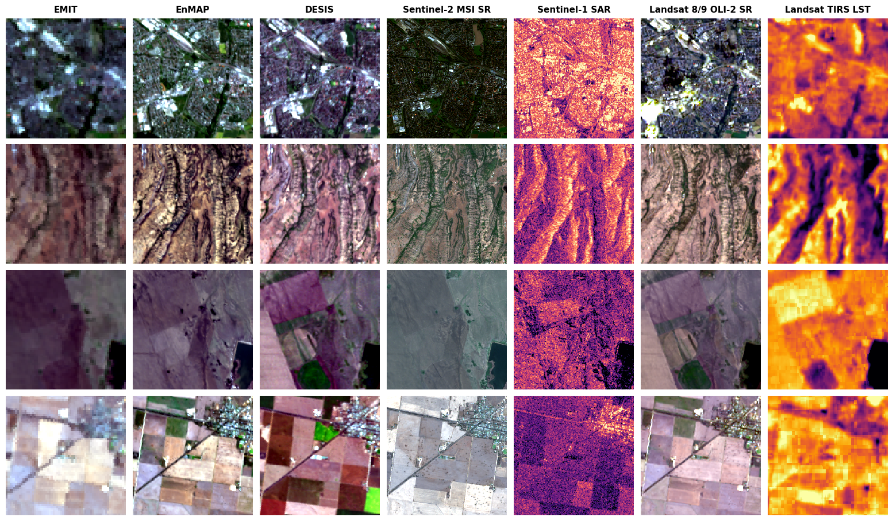
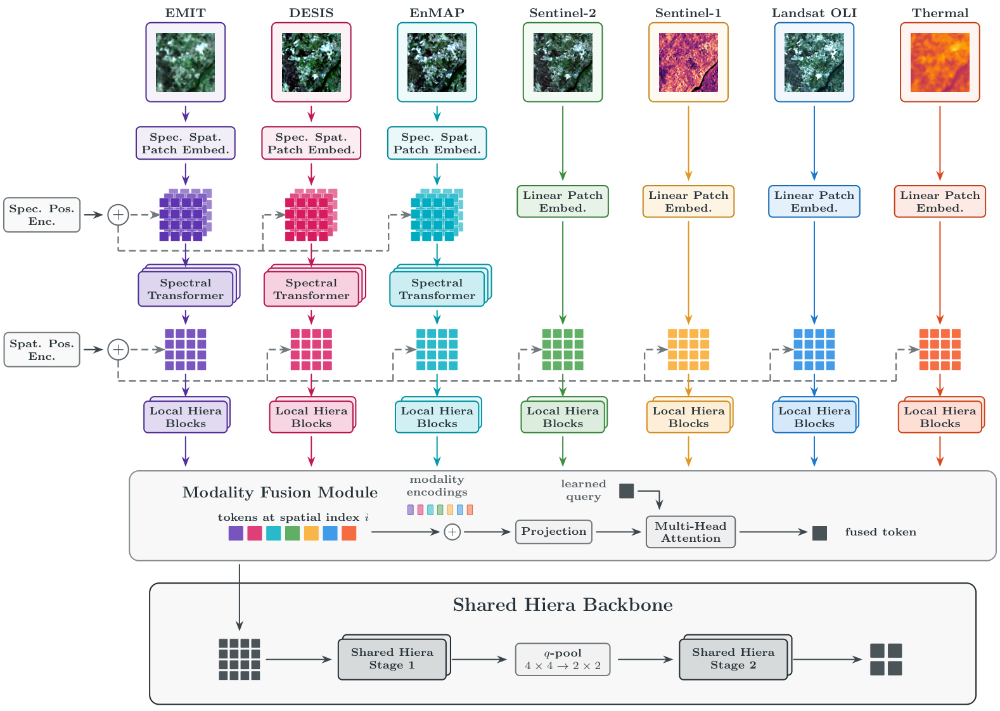
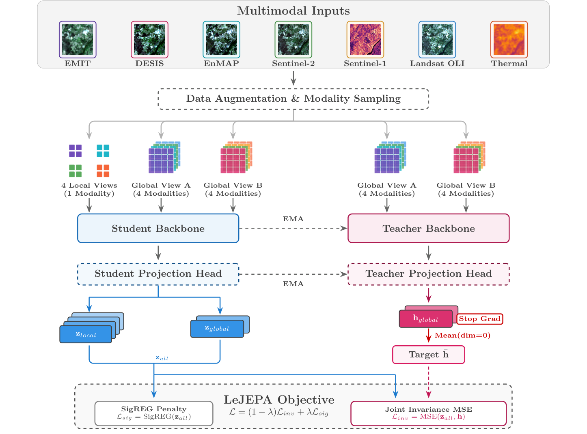

# SpectralEarth-MM Research Codebase

This is the broader SpectralEarth-MM research codebase. It keeps the multisensor SpectralEarth-FM code, selected single-sensor SSL baselines, and comparison backbones for HSI foundation-model experiments.

## Figures

Paper overview:



Dataset map:



Dataset examples:



Architecture:



Pretraining objective:



## Included Model Families

- SpectralEarth-FM multisensor Hiera backbone with grouped HSI spectral tokenization and projected-attention sensor fusion.
- Multimodal LeJEPA pretraining for SpectralEarth-MM.
- Single-sensor SSL baselines: DINO, DINOv2, MAE, MoCo, I-JEPA, and LeJEPA.
- HSI and EO comparison backbones: SpecViT, SpecResNet, DOFA, Panopticon, HyperSIGMA, CARL, SpecAware, ViT/timm, and ResNet/timm.

Removed development-only families include SSMAE, structured masking MAE, factorized/spectral-spatial prototype ViTs, single-sensor Hiera experiment variants, multimodal DINO/I-JEPA/MAE/SSMAE, and Qingpu AMMIS task code.

## Paths

The cluster path profiles are intentionally kept. Useful profiles:

```bash
paths=juwels
paths=default
```

Key locations:

```bash
configs/paths/juwels.yaml
configs/paths/default.yaml
logs/ssl_pretrain_terrabyte/
pretrained_models/comparison/
data/stats/mm_full_flat_normalized_random_single/
```

Install the main Python dependencies with:

```bash
micromamba create -n spectral_earth_mm python=3.11
micromamba activate spectral_earth_mm
pip install -r requirements.txt
```

The default runs use W&B or CSV logging.

## Main Scripts

Pretraining:

```bash
bash scripts/pretrain/run_pretrain.sh
bash scripts/pretrain/run_dino_pretrain.sh
bash scripts/pretrain/run_dino_v2_pretrain.sh
bash scripts/pretrain/run_mae_pretrain.sh
bash scripts/pretrain/run_moco_pretrain.sh
bash scripts/pretrain/run_ijepa_pretrain.sh
bash scripts/pretrain/run_lejepa_pretrain.sh
```

Downstream evaluation:

```bash
bash scripts/downstream/run_benchmark_multisensor_hiera.sh
bash scripts/downstream/run_paper_network_path_ablations.sh
bash scripts/downstream/run_benchmark_joint_fusion_hiera.sh
bash scripts/downstream/run_competitor_benchmarks.sh
bash scripts/downstream/run_baseline.sh
```

Dataset roots, split files, wavelength metadata, and normalization statistics are configured under `configs/`, `data/`, and `configs/sensor/`. The retained scripts assume those assets already exist on the cluster paths.

Quick CPU check for the multisensor downstream script:

```bash
PYTHON_BIN=/p/project1/hai_ssr_msi/aitalibraham1/micromamba/envs/spectral_earth_mm_review_test/bin/python \
LOGGER=csv ACCELERATOR=cpu STRATEGY=auto PRECISION=32-true \
SYNC_BATCHNORM=false FAST_DEV_RUN=true DEVICES=1 NUM_WORKERS=0 BATCH_SIZE=1 \
TRAIN=false TEST=false TASKS_CSV=cdl \
bash scripts/downstream/run_benchmark_multisensor_hiera.sh
```
